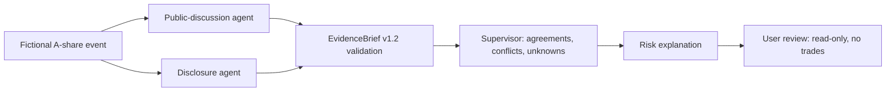
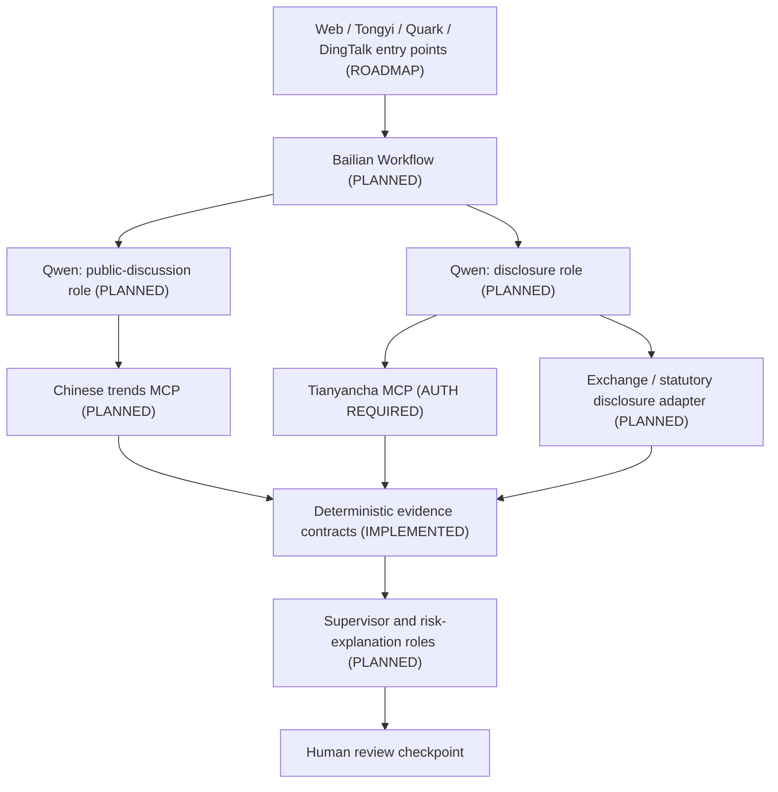
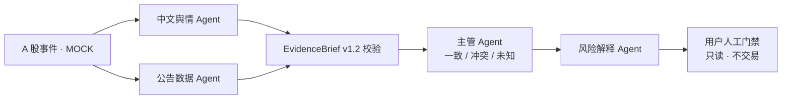
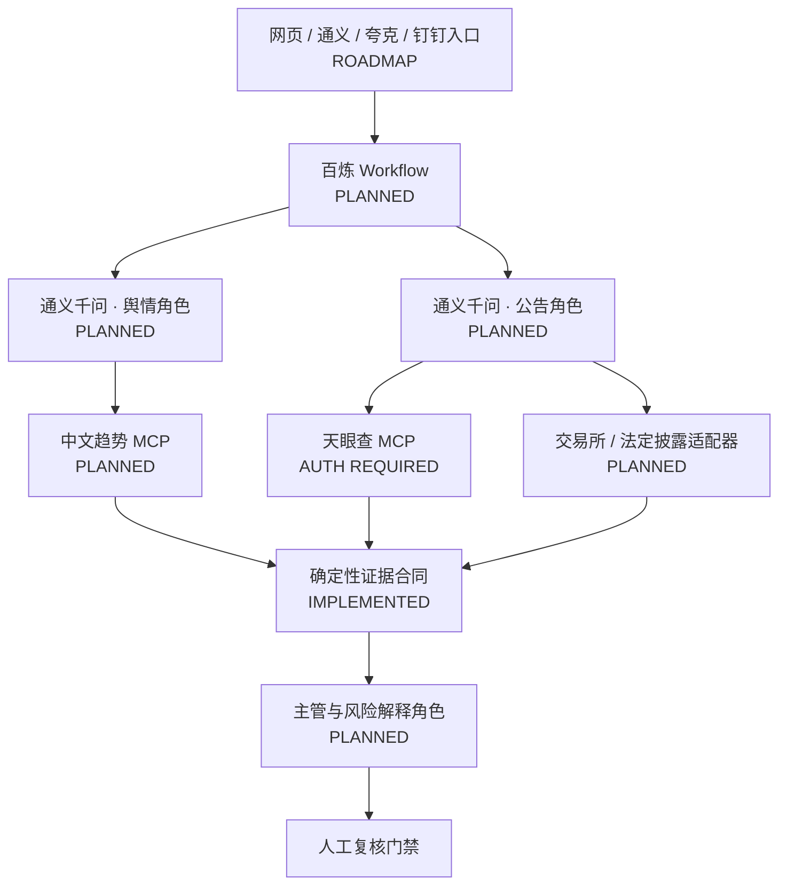

[English](#english) · [简体中文](#zh-cn)

<a name="english"></a>

# OrgLab Sentinel

### A prototype for multi-source evidence verification and risk explanation in China's A-share market

A public-discussion agent and a disclosure agent collect evidence independently. A supervisor preserves agreements, conflicts, and unknowns. A risk-explanation agent explains the evidence without making decisions for the user.

[](https://github.com/mungbean138516-jpg/orglab-sentinel/actions/workflows/ci.yml)


[Live demo](https://mungbean138516-jpg.github.io/orglab-sentinel/) · [90-second demo script (Chinese)](docs/roadshow/07_DEMO_SCRIPT.md) · [Roadshow materials (Chinese)](docs/roadshow/README.md) · [Architecture (Chinese)](docs/roadshow/01_SYSTEM_ARCHITECTURE.md)

> [!IMPORTANT]
> **Proof of concept only. Real-world deployment would require appropriate qualifications and compliance review.** The web demo uses fictional A-share securities and fixed mock data. It does not access real accounts, connect to brokers, recommend securities, forecast returns, or execute trades.

## Overview

OrgLab Sentinel is a reusable evidence-handoff and risk-explanation engine, not an AI trading app. The A-share market is the first test case. The prototype distinguishes facts supported by formal disclosures from inferences drawn from public discussion and questions the available evidence cannot answer, with the goal of reducing errors driven by information gaps and amplified sentiment.

The demo includes three fictional scenarios: a revised earnings forecast, an exchange inquiry, and a supply-chain rumor. It traces evidence IDs, source tiers, freshness, duplicate reports that share an origin, disagreements, and unknowns. Charts show verification thresholds, simulated attention weights, and the mix of confirmed, unverified, and indeterminate items. Crossing a threshold triggers verification, not a price prediction. The report drawer provides the full evidence trail; its human checkpoint records only that the user read the risk notice. The interface never presents a planned integration as connected or live.

The organization experiment compares a flat group chat, a supervisor-and-specialists model, and dynamic risk control under identical inputs. Failure scenarios include a source timeout, stale disclosures, duplicate syndication, conflicting evidence, and failed output validation.

| Status | Meaning | Examples |
| --- | --- | --- |
| `IMPLEMENTED` | Working repository code | Runtime JSON Schema checks, patch ledger, human checkpoint |
| `MOCK ACTIVE` | Runs on fixed fictional inputs | A-share events, disclosures, trending topics, charts |
| `PLANNED` | Designed, not connected or invoked | Alibaba Cloud Bailian, Qwen, ModelScope / EvalScope |
| `AUTH REQUIRED` | Optional external tool requires server-side authorization | Tianyancha MCP |
| `ROADMAP` | Future product direction | DingTalk human review, Tongyi / Quark user entry points |

## Workflow and architecture



| Role | Responsibility | Boundary |
| --- | --- | --- |
| Public-discussion specialist | Finds, ranks, and deduplicates news, trends, and public discussion; isolates rumors | Popularity is not evidence of fact; no trade recommendations |
| Disclosure specialist | Checks exchange disclosures, financial fields, and corporate identity | No target prices or allocation advice |
| Supervisor | Compares the two briefs and preserves disagreements and missing information | Cannot invent facts or silently resolve conflicts |
| Risk explanation | Explains the evidence status and lists what the user can verify | No security recommendations, broker access, or orders |

Today these are logical roles in one React browser app, driven by a deterministic JavaScript state machine, not deployed agents or four live models. AJV validates `EvidenceBrief v1.2`, `SupervisorSynthesis v1.2`, and `UserRiskReport v1.2` at runtime; repository code also checks references across contracts.

## Proposed Alibaba architecture



The proposed architecture uses Bailian to coordinate Qwen roles. MCP is a tool-connection protocol, not an agent or a guarantee of data authenticity: trend tools surface leads, Tianyancha supports corporate-fact cross-checks, and exchange or statutory disclosures take priority for confirmation. ModelScope and EvalScope would provide open resources and evaluation support; DingTalk is a possible human-review channel. None of these external integrations is live. See the [architecture](docs/roadshow/01_SYSTEM_ARCHITECTURE.md), [contracts and safety boundaries](docs/roadshow/04_CONTRACTS_AND_SAFETY.md), and [Alibaba technology map](docs/roadshow/05_ALIBABA_TECHNOLOGY_MAP.md).

## Independent public-data pilot

A separate September 23, 2026 pilot used short summaries of six public news or corporate disclosure documents, with nine Chinese-language claim cases and 27 saved model outputs. Three independent Codex contexts in ChatGPT Work ran one batch per condition. No Qwen, Bailian, or paid model API was called; no model was trained. The pilot is not integrated into the demo.

| Pilot metric | Single source | Multiple sources | Multiple sources with evidence-checking instructions |
| --- | --- | --- | --- |
| Macro-F1 against provisional labels based on all sources | 0.522 | 1.000 | 1.000 |
| Outputs with valid source IDs | 8/9 | 9/9 | 9/9 |
| Abstention decisions matching labels based on the evidence visible in each condition | 9/9 | 9/9 | 9/9 |

Single- and multi-source labels differed on 4/9 claims; the two multi-source conditions differed on none. All three scored Macro-F1 1.000 against their own evidence-scoped reference labels. The observed difference came primarily from access to additional disclosures; it does not establish an improvement from the additional instructions. The set covers only three events, and six claims are explicitly constructed test cases. The assistant-proposed labels await independent human review, and self-reported confidence was not calibrated. The small, easy set does not establish real-world generalization. No user study tested whether people would trust the system more or make better decisions.

The [pilot record](experiments/public_data_pilot_20260923/README.md) contains sources, labeling rationale, fixed prompts, raw outputs, and reproducible metrics. A [case review](experiments/public_data_pilot_20260923/review/README.md) identified summaries and questions to revise; original inputs and outputs remain frozen. The [October 1 revised candidate and source audit](experiments/public_data_pilot_v2_20261001/README.md) adds integrity checks but has no new model outputs or metrics; all nine labels still await human review.

The project lead describes leading a seven-person internship team: breaking down an ambiguous problem, designing modules and the source, evidence, conflict, unknown, and human-review logic, and iterating on inputs, prompts, and module structure. The lead and an AI assistant conducted the later pilot separately; the assistant assembled source summaries, proposed labels, and ran the pilot. It was not part of a deployed Alibaba internship product. See the [advisor progress report](docs/ADVISOR_PROGRESS_20261001.md).

## Run locally

Requires Node.js `>=22.12.0`.

```bash
git clone https://github.com/mungbean138516-jpg/orglab-sentinel.git
cd orglab-sentinel
npm ci
npm run dev
```

Open the address Vite prints, normally `http://localhost:5173/`.

```bash
npm run check
```

This runs contract, evidence-trace, failure-handling, and organization experiment tests, then creates a production build. GitHub Actions runs the same check on pushes and pull requests. CI also runs Python tests for pilot metrics, verifies SHA-256 checks around recomputing the saved results, and checks the revised candidate dataset. The checks do not call any models.

## 90-second walkthrough

1. In **风险情报台** (Risk Intelligence Desk), select **业绩预告修正** (Revised Earnings Forecast) and start the fixed replay.
2. Show the two specialists working in parallel and submitting their respective `EvidenceBrief v1.2` reports.
3. Expand the trend chart and explain that crossing the threshold triggers verification, not a price forecast.
4. Open **查看证据与完整报告** (View Evidence and Full Report) to show facts, conflicts, unknowns, and evidence IDs.
5. Select **我已阅读风险提示** (I Have Read the Risk Notice). This does not place a trade.
6. In **组织实验** (Organization Experiment), inject an evidence conflict or contract failure to demonstrate how the system handles it.
7. In **目标架构** (Target Architecture), outline the proposed responsibilities of Bailian, Qwen, ModelScope, MCP, and DingTalk.

The [full demo script](docs/roadshow/07_DEMO_SCRIPT.md) includes narration, recording cues, and fallback paths.

## Repository map

| Path | Purpose |
| --- | --- |
| `src/App.jsx` | Four interactive views and their state |
| `src/components/RiskVisuals.jsx` | Attention-weight, threshold, and evidence-composition charts |
| `src/data/demoData.js` | Fictional fixtures, agent metadata, and integration statuses |
| `src/lib/contracts.js` | AJV validation and cross-contract reference checks |
| `src/lib/simulation.js` | State machine, failure behavior, patch ledger, and organization experiments |
| `src/styles.css` | Responsive layout and semantic colors |
| `test/simulation.test.js` | Contract, evidence-trace, failure-handling, and experiment tests |
| `docs/contracts/` | Four v1.2 JSON schemas |
| `docs/roadshow/` | Architecture, pitch materials, compliance, and integration notes |
| `.github/workflows/` | CI and GitHub Pages workflows |

### Roadshow and slide materials

The roadshow folder separates what is implemented, what is proposed, and what can be used in the slides.

[Architecture](docs/roadshow/01_SYSTEM_ARCHITECTURE.md) · [Roles and permissions](docs/roadshow/02_AGENT_HIERARCHY.md) · [Event flow](docs/roadshow/03_END_TO_END_EVENT_FLOW.md) · [Contracts and safety](docs/roadshow/04_CONTRACTS_AND_SAFETY.md) · [Alibaba technology map](docs/roadshow/05_ALIBABA_TECHNOLOGY_MAP.md) · [A-share adapter](docs/roadshow/06_A_SHARE_ADAPTER_LAYER.md) · [Demo script](docs/roadshow/07_DEMO_SCRIPT.md) · [Claims and compliance](docs/roadshow/08_CLAIMS_AND_COMPLIANCE_MATRIX.md) · [Stakeholder decisions](docs/roadshow/09_STAKEHOLDER_FEEDBACK_DECISIONS.md) · [11-slide source map](docs/roadshow/10_PPT_SOURCE_MAP.md) · [Connectors and secrets](docs/roadshow/11_CONNECTOR_SETUP_AND_SECRETS.md)

## Secrets and real integrations

`.env.example` holds placeholders only, not live credentials. Keep `DASHSCOPE_API_KEY`, `MODELSCOPE_ACCESS_TOKEN`, `TIANYANCHA_API_KEY`, and ModelScope Hosted MCP remote URLs server-side. Any future integration should route from the browser through a controlled backend or Bailian to the MCP/data provider. Never expose secrets through `VITE_*` variables, Git, logs, screenshots, recordings, or slides. See [connector setup and secrets](docs/roadshow/11_CONNECTOR_SETUP_AND_SECRETS.md).

## Contributing

Keep `main` runnable. There is no need to create eight issues up front: branch from its latest revision and open a focused draft pull request early.

```bash
git switch main
git pull --ff-only
git switch -c frontend/improve-report-drawer
npm run check
```

Coordinate overlapping changes to `App.jsx`, `styles.css`, and shared schemas. Include screenshots or recordings for UI changes. Have a teammate review contract, risk-language, pilot-metric, and connector changes.

## Current limits

This is a front-end prototype, not a production financial system. It has no live market, disclosure, or trends feed; no active Bailian, Qwen, ModelScope, Tianyancha MCP, trend MCP, or DingTalk calls; and no backend authorization, persistent database, identity system, brokerage connection, or trading functionality.

[Jump to Chinese / 跳转中文版](#zh-cn)

---

<a name="zh-cn"></a>

<div align="center">

# OrgLab Sentinel

### A 股多源证据核验与风险解释原型

舆情 Agent 与公告 Agent 分头取证，主管保留一致、冲突和未知项，风险解释 Agent 只负责解释；最终决定始终交还给用户。

[](https://github.com/mungbean138516-jpg/orglab-sentinel/actions/workflows/ci.yml)


[在线演示](https://mungbean138516-jpg.github.io/orglab-sentinel/) · [90 秒演示脚本](docs/roadshow/07_DEMO_SCRIPT.md) · [路演资料包](docs/roadshow/README.md) · [架构说明](docs/roadshow/01_SYSTEM_ARCHITECTURE.md)

</div>

> [!IMPORTANT]
> **仅为概念验证，落地需相应资质与合规评估。** 当前网页演示只使用虚构 A 股证券与固定 MOCK 数据，不接真实账户、不连接券商、不荐股、不预测收益，也不自动执行交易。

## 一句话定位

OrgLab Sentinel 不是“AI 炒股软件”，而是一套可复用的**多源证据交接与风险解释引擎**。A 股只是首个验证场景：它帮助用户看清哪些是官方事实、哪些只是舆情推断、哪些仍然未知，从而减少由信息缺口和情绪共振造成的重大误判。

## 当前能演示什么

- 三个完全虚构的 A 股固定场景：业绩预告修正、交易所问询、供应链传闻；
- 舆情与公告两个专项 Agent 的逻辑并行；
- `EvidenceBrief v1.2`、`SupervisorSynthesis v1.2` 与 `UserRiskReport v1.2` 的运行时 AJV 校验；
- 证据 ID、来源等级、时效、同源去重、冲突和未知项的完整引用链；
- 右侧完整报告抽屉与“只记录已阅读”的人工门禁；
- 趋势阈值图、模拟关注权重图与已确认／待核实／暂无法判断构成；
- 趋势源超时、公告过期、同源转载、证据冲突、合同失败等安全降级；
- 固定输入下对比扁平群聊、主管—专家、动态风控三种组织。

## 状态必须这样读

| 状态 | 含义 | 本项目中的例子 |
| --- | --- | --- |
| `IMPLEMENTED` | 仓库中真实存在的代码能力 | 运行时 JSON Schema 校验、Patch 账本、人工门禁 |
| `MOCK ACTIVE` | 可运行，但输入全部是固定虚构数据 | A 股事件、公告、热搜与图表 |
| `PLANNED` | 已完成概念设计，尚未真实调用 | 百炼、通义千问、ModelScope / EvalScope |
| `AUTH REQUIRED` | 可选外部工具，需要服务端授权 | 天眼查 MCP |
| `ROADMAP` | 后续产品方向 | 钉钉人工复核、通义／夸克用户入口 |

页面不会把 `PLANNED` 冒充成“已连接”或“实时”。

## 独立公开数据验证

2026 年 9 月 23 日完成一次 **independent public-data validation**：使用 6 份公开新闻／公司披露材料的短摘要，建立 9 条中文 claim 案例，对比 single-source、multi-source 和 evidence-aware 三种条件，共保存 27 条实际模型输出。材料、标签依据、固定提示词、原始输出和可重算指标见 [实验记录](experiments/public_data_pilot_20260923/README.md)。

此次调用的是 ChatGPT Work 中的 Codex 会话，每组一次、共三个独立上下文；没有调用 Qwen／百炼或付费模型 API，也没有训练底层模型。试跑属于原型之外的后续独立验证，尚未接入网页。

后续的 [9条案例复核](experiments/public_data_pilot_20260923/review/README.md) 发现摘要与题目需修订，已保存候选版本；原输入和结果保持冻结，独立人工复核仍待完成。

2026 年 10 月 1 日的[修订版候选数据与来源审计](experiments/public_data_pilot_v2_20261001/README.md)将这些修正落成独立版本，并加入输入完整性检查；该版本尚无新模型输出或新分数，9 条人工标签仍全部待审。面向导师的[进展报告](docs/ADVISOR_PROGRESS_20261001.md)区分原实习原型、后续个人试跑、此次修正及未来用户研究。

| 本次试跑结果 | 单来源 | 多来源 | 多来源加证据核验提示词 |
| --- | --- | --- | --- |
| Macro-F1 对照完整材料临时标签 | 0.522 | 1.000 | 1.000 |
| 有有效来源 ID 的输出 | 8/9 | 9/9 | 9/9 |
| 拒答判断符合各自可见材料的标签 | 9/9 | 9/9 | 9/9 |

单来源与多来源有 **4/9** 条标签分歧；两个多来源条件为 **0/9**。因此，这次观察主要是补充公告带来的信息差异，未证明新增提示词改善了分类。三个条件对各自材料内的参考标签均为 Macro-F1 1.000，也说明题目很小且容易，不能据此声称有现实泛化能力。参考标签由助手拟定、待人工复核；置信度只是模型自报值，未经校准。9 条题目来自 3 个事件，其中 6 条是明确标注的构造测试题。

项目负责人提供的原型经历包括：带领七人团队拆解模糊任务、设计模块与 evidence/source/conflict/unknown/human-review 逻辑，并迭代 input、prompt 和模块结构。本次验证由项目负责人与 AI 助手协作，助手整理公开材料、拟定参考标签并执行试跑；不应将本次工作追溯写成实习期间已经上线的阿里产品。此次没有开展用户研究，无法据此判断用户是否更信任或更理性。

## 核心工作流



| 岗位 | 只负责什么 | 明确不能做什么 |
| --- | --- | --- |
| 中文舆情 Agent | 发现新闻、热搜和公开讨论；分级、去重、隔离传闻 | 不能把热度当事实，不能形成交易建议 |
| 公告数据 Agent | 核对交易所公告、财务字段和企业主体信息 | 不能输出目标价或仓位 |
| 主管 Agent | 比较两份简报，保留一致、冲突和未知项 | 不能创造新事实或静默抹平冲突 |
| 风险解释 Agent | 翻译证据状态和用户核验清单 | 不能荐股、连接券商或自动下单 |

当前这些 Agent 是**同一 React 浏览器应用里的逻辑角色**，由确定性 JavaScript 状态机驱动；并不是四个已经部署的平台或四个真实大模型。

## 阿里目标架构



最简洁的技术表达：

> 千问负责分析，百炼负责组织，MCP 负责连接；魔搭及 EvalScope 提供开源资源与评测支持，钉钉把决定交还给人。

MCP 是工具连接协议，不是 Agent，也不是数据真实性证书。中文趋势 MCP 只能发现线索；天眼查 MCP 用于企业事实交叉核验；最终确认仍应优先使用交易所与法定披露来源。

## 快速开始

要求 Node.js `>=22.12.0`。

```bash
git clone https://github.com/mungbean138516-jpg/orglab-sentinel.git
cd orglab-sentinel
npm ci
npm run dev
```

浏览器打开 Vite 输出的本地地址（通常是 `http://localhost:5173/`）。

### 质量检查

完整质量门禁：

```bash
npm run check
```

该命令运行合同、证据链、故障降级与组织实验测试，再生成生产构建。GitHub Actions 在 push 和 pull request 时执行同样的检查。

CI 另运行公开数据试跑的 Python 指标测试、首次运行前后 SHA-256 与已保存结果复算，以及修订版候选数据完整性检查；这些测试不调用模型。

## 90 秒现场路径

1. 在「风险情报台」选择“业绩预告修正”，点击运行固定回放。
2. 指出两位专项 Agent 逻辑并行，并分别提交 `EvidenceBrief v1.2`。
3. 展开趋势阈值图：越过阈值只触发核验，不预测股价。
4. 点击“查看证据与完整报告”，展示事实、冲突、未知项和引用 ID。
5. 点击“我已阅读风险提示”，强调它不会触发交易。
6. 去「组织实验」注入“公告与舆情冲突”或“输出合同失败”，展示系统安全降级。
7. 去「目标架构」，用一页解释百炼、千问、魔搭、MCP 与钉钉各自的职责。

完整逐句旁白、录屏时间轴与故障备选见 [Demo 脚本](docs/roadshow/07_DEMO_SCRIPT.md)。

## 目录

```text
src/
  App.jsx                     # 四个可点击页面与交互状态
  components/RiskVisuals.jsx  # 关注权重、阈值和证据构成图
  data/demoData.js            # A 股虚构 fixture、Agent 与连接状态
  lib/contracts.js            # AJV 运行时合同校验与跨合同引用检查
  lib/simulation.js           # 管线状态、故障、拒收降级、Patch 账本与组织实验
  styles.css                  # 响应式设计与颜色语义
test/
  simulation.test.js          # 合同、证据链、降级和实验测试
docs/
  contracts/                  # 四个 v1.2 JSON Schema
  roadshow/                   # 架构、PPT、演示、合规与接入资料
.github/
  workflows/                  # CI 与 GitHub Pages
```

## 路演与 PPT 素材

`docs/roadshow/` 已把工程真相、目标愿景和 PPT 素材分开：

- [系统架构：当前 Prototype vs 目标架构](docs/roadshow/01_SYSTEM_ARCHITECTURE.md)
- [Agent 层级与权限](docs/roadshow/02_AGENT_HIERARCHY.md)
- [端到端事件流](docs/roadshow/03_END_TO_END_EVENT_FLOW.md)
- [合同与安全边界](docs/roadshow/04_CONTRACTS_AND_SAFETY.md)
- [阿里技术图谱](docs/roadshow/05_ALIBABA_TECHNOLOGY_MAP.md)
- [A 股适配层](docs/roadshow/06_A_SHARE_ADAPTER_LAYER.md)
- [90 秒 Demo 脚本](docs/roadshow/07_DEMO_SCRIPT.md)
- [宣传与合规矩阵](docs/roadshow/08_CLAIMS_AND_COMPLIANCE_MATRIX.md)
- [团队反馈决策日志](docs/roadshow/09_STAKEHOLDER_FEEDBACK_DECISIONS.md)
- [11 页 PPT 素材映射](docs/roadshow/10_PPT_SOURCE_MAP.md)
- [连接器、依赖与密钥安全](docs/roadshow/11_CONNECTOR_SETUP_AND_SECRETS.md)

## 密钥与真实接入

仓库只保存 `.env.example` 占位符，绝不保存真实：

- `DASHSCOPE_API_KEY`
- `MODELSCOPE_ACCESS_TOKEN`
- `TIANYANCHA_API_KEY`
- ModelScope Hosted MCP Remote URL

任何真实接入都必须走：

```text
浏览器 → 自有后端 / 百炼 → MCP 或数据服务
```

密钥不能使用 `VITE_*` 暴露到前端，也不能出现在 Git、截图、录屏、日志或 PPT 中。完整规则见 [连接器与密钥](docs/roadshow/11_CONNECTOR_SETUP_AND_SECRETS.md)。

## 协作

`main` 保持为可运行基线。团队成员无需先拆八个 Issue；从最新 `main` 创建聚焦分支，尽早开 Draft PR：

```bash
git switch main
git pull --ff-only
git switch -c frontend/improve-report-drawer
npm run check
```

跨模块修改时优先避免多人同时重写 `App.jsx`、`styles.css` 或共享 Schema。UI 变化附截图或录屏；合同、风险文案、实验指标与外部连接器需交叉审阅。

## 最后边界

这是一套可路演的前端概念原型，不是生产金融系统。它尚未实现真实行情、公告或热搜接入，未真实调用百炼、千问、魔搭、天眼查 MCP、趋势 MCP 或钉钉，也没有后台权限、持久化数据库、身份系统、券商连接或交易能力。
